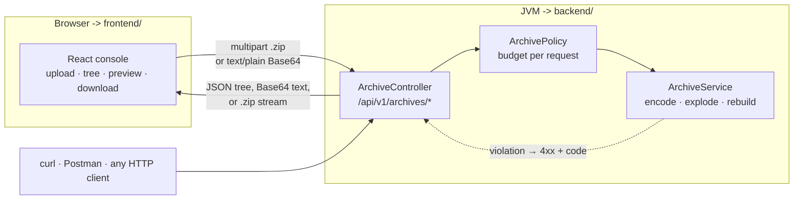

# zip-codec

Turn a ZIP archive - recursive folders, nested archives and all, into Base64 text,
and turn it back into the same bytes.

This repository holds two applications that are developed together and run together:

| Folder | What it is | Stack | README |
|---|---|---|---|
| **[`backend/`](backend)** | The ZIP to Base64 and vise versa, in a HTTP service. All archive logic and every security guard lives here. | Spring Boot 3.5, Java 21 | [backend/README.md](backend/README.md) |
| **[`frontend/`](frontend)** | A browser console for the service: upload, explode, preview, rebuild, download. | React 19, Vite, TypeScript, Mantine | [frontend/README.md](frontend/README.md) |

The backend is useful on its own, it is a plain REST API, and `curl` is a first-class client. 
The frontend is a convenience layer; it holds no archive logic of its own.

---

## Why this exists

Some systems can only carry text. A message queue with a JSON-only contract, a form field, an audit log,
a database column, an email body. An archive is binary, so it cannot travel that way unchanged.

Base64 is the usual answer, but the naive version, read the whole file into memory,
call `encodeToString`, hope for the best, falls over in three ways this project takes seriously:

- **Memory.** A 200 MB archive becomes a ~267 MB string plus the original bytes.
  The streaming endpoints encode in constant memory instead.
- **Trust.** An uploaded ZIP is attacker-controlled. Zip bombs, Zip Slip paths,
  and nested archives are handled as a policy budget, not as an afterthought.
- **Fidelity.** "It produced a file" is not the same as "it produced *the* file".
  The round trip is verified byte-for-byte by SHA-256.

---

## Quick start

Two terminals. The backend must be running before the frontend is useful.

```bash
# Terminal 1, the service
cd backend
mvn spring-boot:run          # http://localhost:8080

# Terminal 2, the console
cd frontend
npm install                  # first run only
npm run dev                  # http://localhost:5173
```

Open <http://localhost:5173>. The header shows a **backend** badge; green means the dev server's proxy
reached the service's health endpoint.

---

## Backend & Frontend flow



In development the Vite dev server proxies `/api` and `/actuator` to `localhost:8080`.<br>
Live demo application could be seen at [ZIP Codec Portal](https://zcodec.mohniudanri.my.id)

---

## What it can do
**Input is ZIP only**, in both directions. RAR, 7z, tar and tar.gz are not read as archives.
Formats that are ZIP containers underneath: `.docx`,
`.xlsx`, `.jar`, `.apk`.
