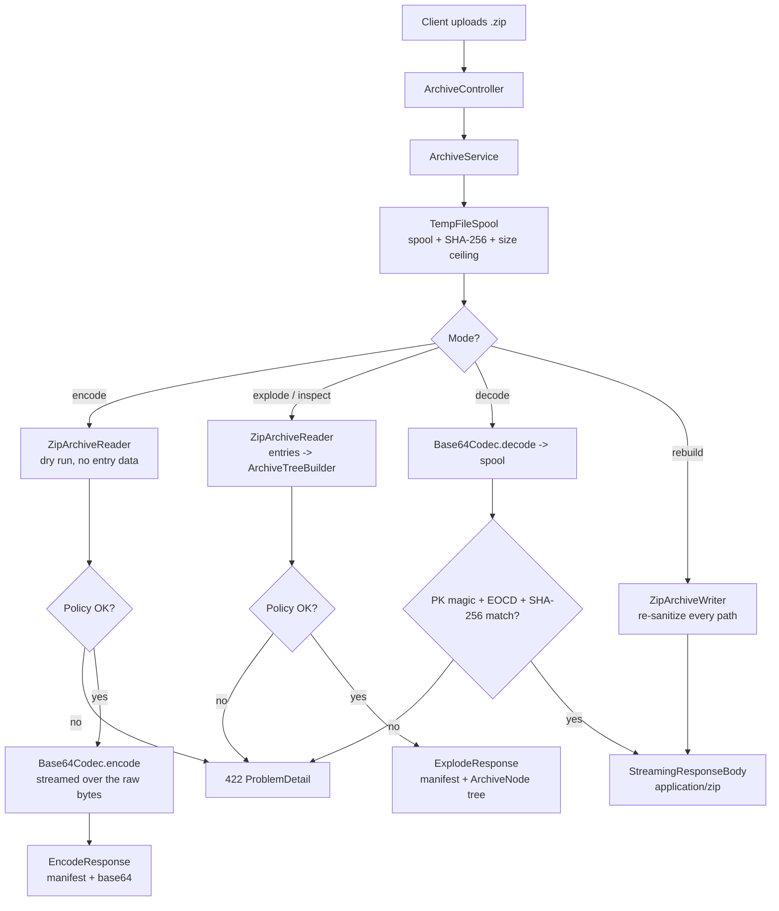
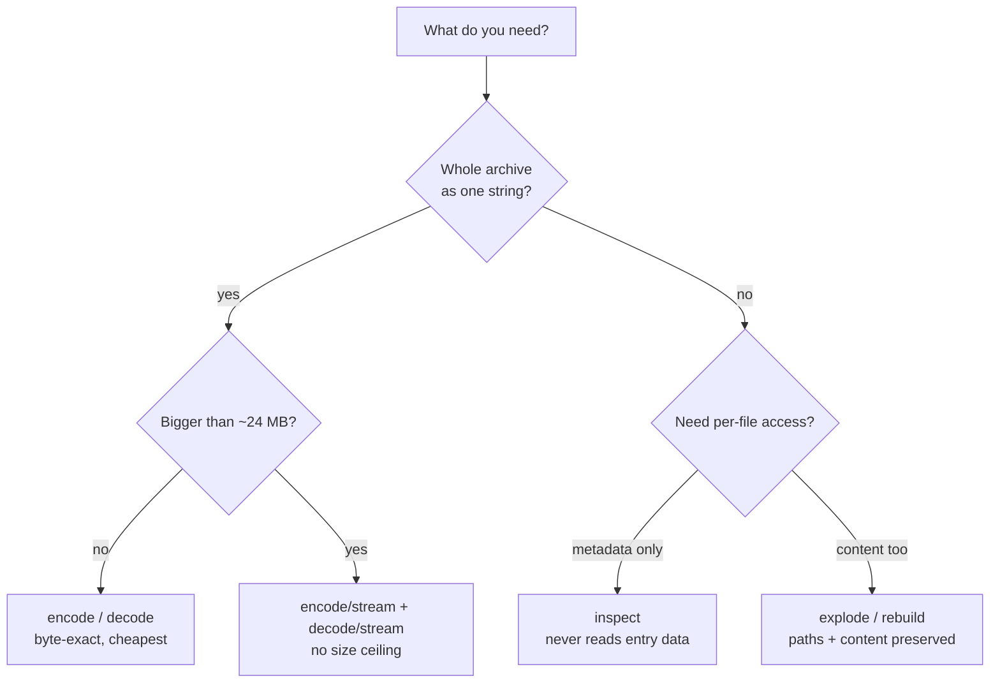

# ZIP Codec Service - single-module edition

Spring Boot service that converts a ZIP archive (with recursive folders, files and
nested archives) into Base64 text, and back again.

---

## Useful links

The detail lives in [`docs/`](docs). Start with the operation you need:

| Document | What it covers                                                                                               |
|----------|--------------------------------------------------------------------------------------------------------------|
| **[Encode & decode simple](docs/encode-decode.md)** | The JSON pair. Byte-exact round trip for archives under ~24 MB                                               |
| **[Encode & decode stream](docs/encode-decode-stream.md)** | The raw `text/plain` pair. Constant memory, no size ceiling, **use this for anything large or shell-driven** |
| **[Explode](docs/explode.md)** | Archive, recursive JSON tree with one Base64 payload per file                                                |
| **[Inspect](docs/inspect.md)** | The same tree, metadata only, entry data is never read                                                       |
| **[Rebuild](docs/rebuild.md)** | A JSON tree back to a new `.zip` (not byte-exact, read the caveats)                                          |

---
## End-to-end flow


### Why spool to a temporary file first?
`ZipFile` needs **random access** to read the central directory, and the central
directory is what exposes each entry's *compressed* size, the number the
compression-ratio (zip-bomb) guard is built on. Spooling also lets the SHA-256
digest and the upload-size ceiling be computed in the same single pass.

### Why validate decode *before* responding?
The ZIP magic bytes, the end-of-central-directory record and the optional SHA-256
are checked while the payload is still in the spool. Validating inside the
`StreamingResponseBody` would be too late: HTTP 200 would already have been
committed, so a corrupt payload could not be reported.
---

## Technology stack
* Spring Boot 3.5 (Web MVC)
* Apache Commons Compress - ZIP encoding & decoding
* Base64 - encode & decode string
* Apache Tika Core - MIME detection
* Spring doc OpenAPI - API documentation
* Java 21 - Virtual Thread, pattern-matching, sealed class
* Maven 3.5 or later
---

## API documentations

| Mode | Endpoint | What you get                                                     | Docs                               |
|------|----------|------------------------------------------------------------------|------------------------------------|
| **Encode** | `POST /api/v1/archives/encode` | The whole `.zip` as **one** Base64 string, inside JSON           | [->](docs/encode-decode.md)        |
| **Encode (stream)** | `POST /api/v1/archives/encode/stream` | The same Base64 as streamed `text/plain`, in constant memory     | [->](docs/encode-decode-stream.md) |
| **Explode** | `POST /api/v1/archives/explode` | A **recursive JSON tree**, one Base64 payload per file           | [->](docs/explode.md)              |
| **Inspect** | `POST /api/v1/archives/inspect` | The same tree, **metadata only**, entry data is never read       | [->](docs/inspect.md)              |
| **Decode** | `POST /api/v1/archives/decode` | The original `.zip` stream, byte-for-byte                        | [->](docs/encode-decode.md)        |
| **Decode (stream)** | `POST /api/v1/archives/decode/stream` | The same, from a raw `text/plain` Base64 body , no JSON wrapping | [->](docs/encode-decode-stream.md) |
| **Rebuild** | `POST /api/v1/archives/rebuild` | A `.zip` stream reassembled from a tree                          | [->](docs/rebuild.md)              |

`encode` ⇄ `decode` is byte-exact. `explode` ⇄ `rebuild` preserves entry paths and
content, but not ZIP metadata such as timestamps or the compression method.

> **Input is ZIP only**, in both directions. RAR, 7z, tar and tar.gz are not read
> as archives. Formats that are ZIP containers underneath: `.docx`, `.xlsx`,
> `.jar`, `.apk`, work today.

---

## Build and run

```bash
mvn clean verify
mvn spring-boot:run
```

## Tests
```bash
mvn verify
mvn -Dtest=ArchiveServiceTest test
```

## Supported URLs
| URL | Purpose |
|-----|---------|
| `http://localhost:8080/swagger-ui.html` | Interactive API docs |
| `http://localhost:8080/v3/api-docs` | OpenAPI JSON |
| `http://localhost:8080/actuator/health` | Liveness check |
---

## Choosing a mode

| If you want | Use | Byte-exact                     |
|-------------|-----|--------------------------------|
| My archive back, unchanged | [decode / decode-stream](docs/encode-decode-stream.md) | **yes**                        |
| To know what is inside | [inspect](docs/inspect.md) | n/a                            |
| The individual files | [explode](docs/explode.md) | n/a                            |
| A *modified* archive | [rebuild](docs/rebuild.md) | no, signatures are invalidated |
